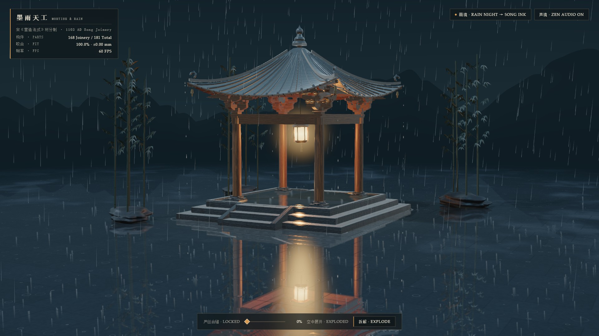
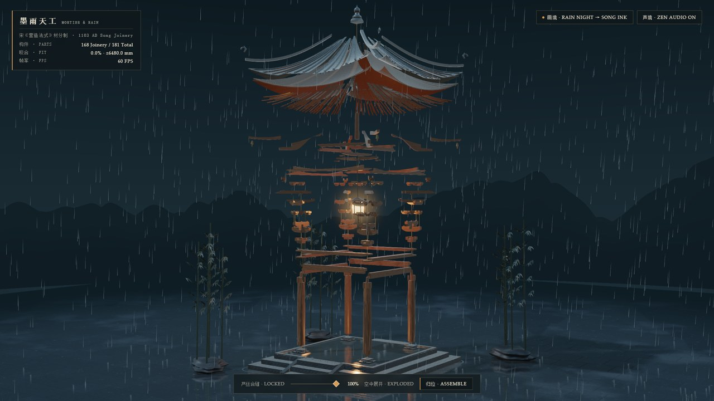
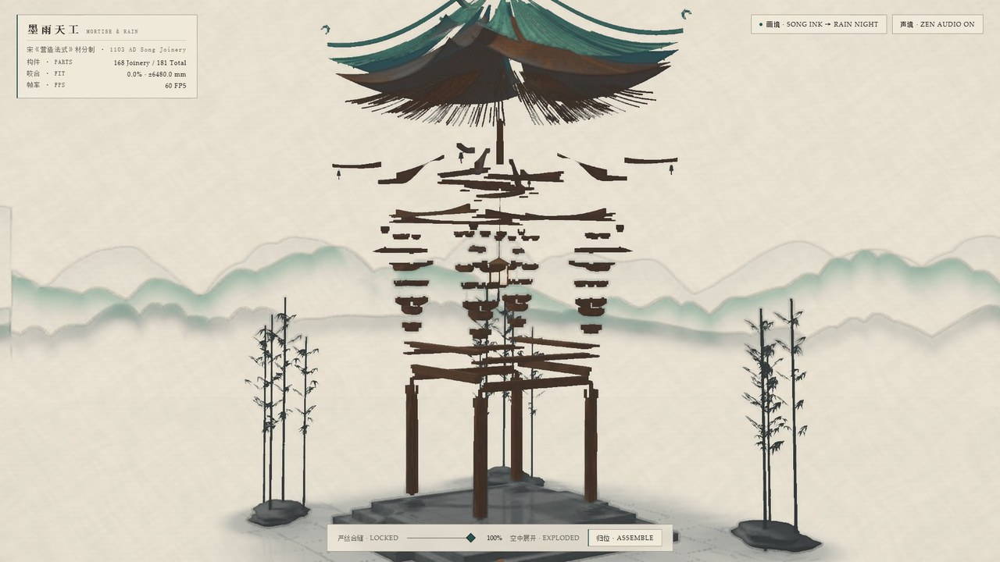
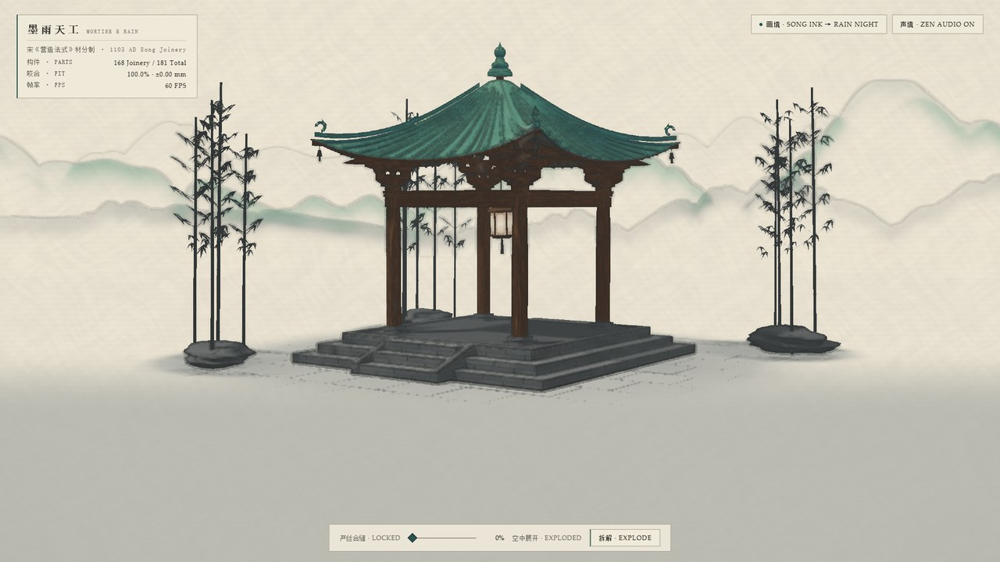

# 墨雨天工 · Mortise & Rain — 181-Part Song Dynasty Timber Joinery

[](https://mortise-and-rain-song.web.app)
[](index.html)
[](https://x.com/jianzhang1987)
[](LICENSE)

> **👉 [Launch Live Interactive Experience (`https://mortise-and-rain-song.web.app`)](https://mortise-and-rain-song.web.app)**  
> *Author: **Jian Zhang** ([@jianzhang1987 on X](https://x.com/jianzhang1987)) · Built in Google Antigravity with **Gemini 4 Carbon***



A millimeter-accurate **1103 AD Northern Song Dynasty (*Yingzao Fashi* 宋《营造法式》材分制)** mortise-and-tenon (*Dougong* 斗栱) courtyard pavilion coded **entirely from scratch in a single self-contained HTML file (`index.html`, 4,525 lines)**—with **zero external 3D models (`.glb`/`.obj`), zero external textures/images, zero audio files, and zero external fonts**.

Every flared dovetail tenon (*燕尾榫*), concave capital bearing scoop (*栌斗欹*), curved bracket soffit (*卷杀华拱*), upturned corner flying rafter (*反宇飞椽*), wet bluestone courtyard reflection, Song blue-green ink scroll brushwork, and wooden mortise knock is synthesized procedurally in real time.

---

## Visual & Structural States

| I. 12-Layer Spring Disassembly (Rain Night) | II. Mid-Air Ink Transformation (`uInkMix`) | III. 1103 AD Song Blue-Green Ink Scroll |
| :---: | :---: | :---: |
|  |  |  |
| *168 interlocking wood & glazed-tile parts exploding along plumb carpentry axes (`35 ms` topological stagger)* | *Continuous shader cross-dissolve between physically based rain reflections and painterly brushwork* | *8-sector Anisotropic Kuwahara filter, mineral azurite/malachite (`石青/石绿`) & Sobel/DoG Feibai outlines on Xuan paper* |

---

## Core Engineering Highlights

### 1. 181 Millimeter-Exact Procedural Meshes (`±0.00 mm` Fit, `L0–L12`)
Modeled directly in metric coordinates (`1.000 unit = 1.000 m`, `0.001 unit = 1 mm`) following Li Jie's **1103 AD *Yingzao Fashi*** standard *cai* (`材`, `180 mm × 120 mm`), `2.640 m` square bay span (`面阔 = 进深`), and `5.530 m` lotus-finial apex:

| Layer | Traditional Elements | Elevation `Y (m)` | Procedural Joinery Geometry | Meshes |
| :--- | :--- | :--- | :--- | ---: |
| **L0** | 三出陛青石台基 · 垂带踏跺 · 覆盆柱础 | `0.000 – 0.600` | Chamfered 3-tier ashlar bluestone plinth, sloped stair cheek stones (`垂带石`), stepped `象眼` spandrels & `78×78×72 mm` column-base mortise sockets (`管脚卯口`) | 13 |
| **L1** | 宋式梭柱 (Entasis Columns) | `0.546 – 3.002` | Upper-1/3 Song entasis taper, bottom `管脚榫`, `112 mm` column-head `十字卯口` & central `馒头榫` | 4 |
| **L2** | 阑额 (Architrave Tie Beams) | `2.660 – 2.840` | Complementary flared dovetail half-tenons (`燕尾半榫`) locking into column-head mortises | 4 |
| **L3** | 普拍枋 (T-Plate Tie Ring) | `2.840 – 2.940` | Corner half-lap cross-notches (`十字刻半搭交`) + square `馒头榫` through-mortise | 4 |
| **L4** | 转角铺作 · 栌斗 (Capital Blocks) | `2.940 – 3.120` | Concave *Dou-qi* (`斗欹`) scoop, bottom `馒头卯眼` & 4 raised *Dou-er* forming `3.048 m` cross troughs | 4 |
| **L5** | 第一跳华拱 · 泥道拱 | `3.048 – 3.243` | Smooth *Juansha* (`卷杀`) curved soffits, `十字刻半卡口` lap joints & tip `暗销凸榫` | 8 |
| **L6** | 外跳交互斗 · 散斗 · 齐心斗 | `3.218 – 3.338` | Seated flush at `3.218 m`; bottom pin mortises + cross/single/45°-diagonal upper troughs (`3.290 m`) | 20 |
| **L7** | 瓜子令拱 · 斜华拱 · 批竹耍头 | `3.290 – 3.512` | Flush `3.290 m` trough seating (`0.00 mm` error) & Song *Pizhu* (`批竹`) beveled `耍头` | 16 |
| **L8** | 令拱散斗 · 耍头齐心交互斗 | `3.422 – 3.638` | `98 mm` purlin-bearing troughs (`3.491 m`) & `100 mm` 45° corner-beam slots (`3.578 m`) | 20 |
| **L9** | 撩檐槫 · 平槫 · 太平梁 · 雷公柱 | `3.491 – 4.976` | Curved `生头木` riser tracking *Fanyu* lift, stepped-collar `太平梁`, hollow-mortised `雷公柱` & `#FF9A3C` palace lantern | 11 |
| **L10** | 老角梁 · 子角梁（附檐角风铎） | `3.580 – 4.161` | Lofted hip beams clearing `平槫`/`撩檐槫` + stepped scarf-lap upturned *Fanyu* `子角梁` & 4 bronze wind bells | 8 (+4) |
| **L11** | 圆椽 · 飞椽（飞子） | `3.377 – 4.391` | Non-intersecting cylindrical `圆椽` & square `飞椽` beneath curved roof sheathing (`0` vertex penetrations) | 40 |
| **L12** | 望板 · 筒板瓦当滴水 · 垂脊 · 攒尖宝顶 | `3.396 – 5.530` | Song *Juzhe* (`举折`) + *Fanyu* (`反宇`) curved roof, `交戗`-trimmed barrel/pan tiles, *Wadang*/*Dishui* & lotus finial | 29 |
| **Total** | **Named Architectural Meshes** | | **168 Explodable Joinery Meshes + 13 Grounded Stone Meshes (+ 5 Courtyard Props)** | **181 (+5)** |

### 2. Analytical Underdamped Spring Disassembly ($\zeta = 0.74$)
Rather than keyframe animations or unstable frame-delta Euler integration, every layer `L1–L12` evaluates a closed-form underdamped second-order step response ($\zeta = 0.74$, $\omega_n = 7.6\text{ rad/s}$) with `35 ms` outer-to-inner topological stagger on disassembly and inner-to-outer stagger + physical mortise-shoulder hard-stop (`p >= 0`) on assembly:

$$p(\tau) = p_1 + e^{-\zeta\omega_n\tau}\!\left(\Delta_0\cos(\omega_d\tau) + \frac{v_0 + \zeta\omega_n\Delta_0}{\omega_d}\sin(\omega_d\tau)\right)$$

### 3. Dual Custom GLSL Rendering Pipeline (`Rain Night PBR ⇄ Song Ink Scroll`)
- **Mode A — Rain-Night Courtyard (`uInkMix = 0.0`)**:
  - Procedural 3D FBM quarter-sawn Chinese fir (`杉木`) wood grain & Mikkelsen screen-space surface-gradient bush-hammered bluestone (`剁斧青石`).
  - **4× MSAA dual planar mirror reflection passes** (`y = 0.000 m` flooded slate courtyard & `y = 0.4805 m` upper plinth) perturbed by expanding concentric raindrop ripples and 2-layer eave-corner capillary wave trains.
  - IGN-rotated PCSS soft shadows, swaying courtyard bamboo shadows (`竹影摇曳`), warm `#FF9A3C` volumetric lantern glow, 4-tap RGSS supersampling, and AgX tone mapping + Edge-Directed FXAA.
- **Mode B — Song Dynasty Blue-Green Ink Scroll (`uInkMix = 1.0`)**:
  - Real-time structure-tensor **8-sector Anisotropic Kuwahara** painterly filter.
  - Mineral azurite/malachite (`石青 / 石绿`) roof glaze & cool sumi ink remap over domain-warped bark-fiber Xuan paper (`宣纸`) with distant mountain mist (`远山烟波`) and depth-modulated **Sobel/DoG *Feibai* (`飞白`) dry-brush outlines**.

### 4. 100% Procedural Web Audio (`ZenAudioEngine`)
- **Timber-Volume-Pitched Mortise Knocks**: Sample-accurate fractional-delay **Karplus-Strong waveguide** blended with orthotropic free-bar woodblock modes (`1 : 2.756 : 5.404`), pitched per part volume ($f_0 \propto V^{-0.24}$, `145–980 Hz`) as layers unlock and seat flush.
- **Courtyard Rain & Just-Intonation Guqin**: Filtered pink-noise rain on glazed tiles & swaying bamboo leaves, ceramic eave-droplet upward chirps, and 5-tone Just-Intonation pentatonic (`宫商角徵羽`) **Guqin (`古琴`)** harmonics triggered by corner wind bells and scroll transitions.

---

## Interactive Controls & Quick Start

### Play Instantly Online
Open **[https://mortise-and-rain-song.web.app](https://mortise-and-rain-song.web.app)** in any modern desktop or mobile browser.

| Control | Action |
| :--- | :--- |
| **Left-Drag / Touch-Drag** | Orbit around the pavilion (`FOV = 28°` architectural lens) |
| **Scroll / Pinch** | Zoom in to inspect millimeter-level *Dougong* tenons & mortise troughs |
| **Hover / Click Any Part** | Highlight individual structural timber/tile (`L0–L12`), dimensions & carpentry role; tap wind bells or lantern to chime |
| **`[E]` or `[Space]`** (or Bottom Slider) | Trigger `100%` topological spring disassembly / lock-in assembly |
| **`[I]`** (or Top-Right `画境` Button) | Cross-dissolve smoothly between **Rain Night PBR** and **Song Ink Scroll** |
| **`[M]`** (or Top-Right `声境` Button) | Toggle procedural Web Audio rain, mortise wood knocks & Guqin harmonics |

### Run Locally (Zero Build Step)
`index.html` has zero build step—serve the directory with any static HTTP server (needed only for ES module `importmap` CORS):

```bash
git clone https://github.com/opdaer/mortise-and-rain.git
cd mortise-and-rain
python -m http.server 8080
# Open http://localhost:8080
```

### Deterministic 1080p60 Showcase Video Recorder (`record_showcase.py`)
`index.html` exposes deterministic time/state hooks (`window.renderAt(t)`, `window.setExplode()`, `window.setInkMix()`, `window.setCameraPose()`, `window.getStats()`) so headless Chromium + FFmpeg can render a bit-exact `1920×1080 @ 60fps` showcase MP4 with sample-accurate 48kHz stereo Zen audio:

```bash
pip install playwright numpy pillow
python record_showcase.py
```

### Deploy to Firebase Hosting
```bash
npx firebase-tools deploy --only hosting
```

---

## Companion Gemini 4 Carbon Project

- **[`opdaer/lotus-rain-cuda`](https://github.com/opdaer/lotus-rain-cuda)** — Pure CUDA & C++20 macro optical ray-tracer simulating **65,536 superhydrophobic raindrops** beading across a sunlit lotus pond with coupled 48kHz C++ Minnaert bubble & Bessel leaf acoustics (`0` engines, `0` 3D libraries, `0` external assets).

---

## Author & License

Created by **Jian Zhang** — follow updates & behind-the-scenes prompts on X: **[@jianzhang1987](https://x.com/jianzhang1987)**.  
Released under the [MIT License](LICENSE).
